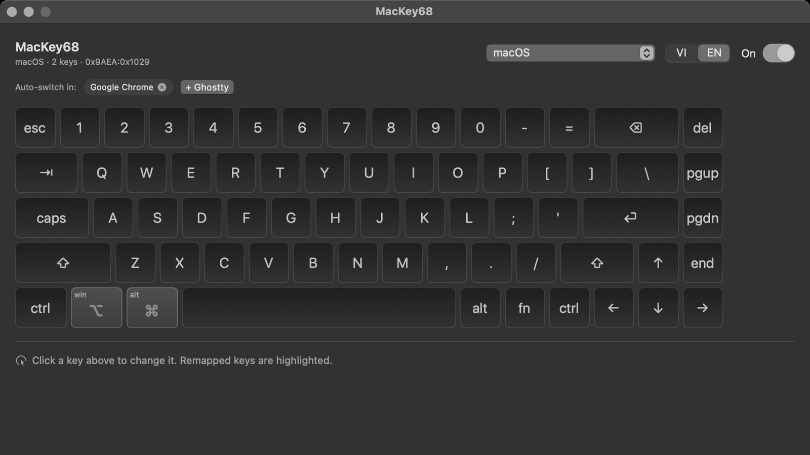

# MacKey68 — turn a Ziyoulang K68 into a macOS keyboard


<a id="english"></a>
**English** · [Tiếng Việt](#tiếng-việt)

Short answer to "is there an app like Razer Synapse / G Hub for the K68 on macOS?":

**No.** Ziyoulang doesn't ship macOS software for the K68, and no third-party app
supports this board (sharkfin covers 1400+ ROYUAN boards but not Ziyoulang; VIA/QMK
doesn't either, since this isn't a QMK board).

But **you don't need vendor software**. This board (OnMicro BLE) emits standard HID
usages, so it can be remapped cleanly at the OS level. This repo is that app. It also
handles other standard HID keyboards: 65%/68-key, TKL and full-size boards.

<p align="center">
  
</p>

*The keyboard window: click any key to remap it. Remapped keys are highlighted, and the
profile switches automatically when you open a linked app.*

## The keyboard

```
$ mackey list
Keyboards:
  0x9AEA:0x1029  OnMicro K68 BT5.0  [Bluetooth Low Energy]
```

Its HID report descriptor shows:

| Property | Value |
|---|---|
| Chip | OnMicro (BLE) |
| VID:PID | `0x9AEA:0x1029` |
| Report interval | 8 ms (125 Hz) |
| Keyboard | boot protocol, 8-bit modifier + 6-key array (6KRO, no NKRO) |
| Consumer page | yes, usages `0x01…0x3FF` (media/volume) |
| Layout descriptor | ANSI, usage range `0x00…0xFF` |

Key consequence: **Fn is handled in firmware**, so `Fn+...` emits a normal HID usage
(for example `Fn+PgUp` → `Home`). OS-level remapping therefore works even for keys
that are only reachable through Fn.

## Multiple keyboards and layouts

MacKey68 isn't tied to the K68. Any external keyboard that speaks standard HID can be
managed, and the drawn board adapts to one of three layouts:

| Layout | Keys | Typical boards |
|---|---|---|
| `68` | 68 | Ziyoulang K68, most 65% boards |
| `tkl` | 87 | Edra EK387 Pro, TKL boards |
| `full` | 104 | Full-size boards with a numpad |

- The app scans external keyboards at launch and on every plug/unplug. New boards are
  added automatically with the detected layout and start receiving mappings. The
  built-in Apple keyboard and gaming mice that expose a stray keyboard collection are
  ignored.
- Open the keyboard window and use the **Keyboard** picker to switch boards; the
  **Layout** picker (68 / TKL / Full) changes the drawing. The choice is saved per
  device.
- Every enabled keyboard receives the active profile's mappings, so swapping one board
  for another keeps the Mac layout. `mackey list` shows each board plus its detected
  layout, and `mackey layouts` lists the three layouts.

> The Edra EK387 Pro appears as `SONiX USB DEVICE` (`0x0C45:0x7644`). It is detected as
> TKL automatically; if a board is guessed wrong, change the Layout picker once.

## Three ways to get a Mac layout

**1. Hardware Mac mode (try this first, 5 seconds).**
K68 firmware families usually ship an OS mode:

| Combo | Mode |
|---|---|
| `Fn+S` | Windows |
| `Fn+A` | Android |
| `Fn+D` | **macOS** |
| `Fn+F` | iOS |

Press `Fn+D`, then retest the Command/Option keys and the F row. If it works, you're
done. (Some revisions use `Fn+Z`/`Fn+X` for Win/Mac — try both.)

> **Tested on this board:** `Fn+D` just typed `d`; `` ` `` only came from `Fn+Esc`.
> The firmware has no Mac mode, so remapping has to happen at the macOS level (option 3).

**2. Fix the macOS "Keyboard Type".**
If characters come out wrong (`@` becomes `"`, no backtick), it's not a layout bug but
macOS guessing ANSI/ISO/JIS wrong:
System Settings → Keyboard → *Change Keyboard Type…* → ANSI.

**3. Remap with `mackey` (this repo).**
Use it when you want specific swaps: Caps → Esc, Right Alt → Right Command, swap
`Ctrl`/`Option`, turn `Fn+PgUp` (which sends `Home`) into `Cmd+Left`, and so on.

## Install

Requirements: macOS 13+, Command Line Tools (`xcode-select --install`). Xcode is not
needed.

```bash
swift build -c release
ln -sf "$PWD/.build/release/mackey" /usr/local/bin/mackey
```

### Menu-bar app (recommended)

```bash
./scripts/install-app.sh
```

The script packages the SwiftUI app as `~/Applications/MacKey68.app` (no Xcode),
registers the `com.mackey68.app` LaunchAgent so it starts at login, and keeps remap
across unplug/replug. Normally it lives only in the menu bar; while the keyboard
window is open its icon appears in the Dock and disappears when you close the window.

Open the drawn keyboard — any of these:

- Click **MacKey68** in Launchpad / Finder (even when the app is already running).
- Menu bar → keyboard icon → **Open keyboard…**
- Terminal:

```bash
mackey board
# or: open "mackey68://board"
```

> Don't use `open MacKey68.app --args --board` while the app is running: macOS treats it
> as reopening an existing app and ignores the arguments. Use `mackey68://board` above.

In that window:

- Click a key on the drawing to select it, then pick the target key. Remapped keys are
  highlighted and keep the original label in the corner so you don't lose track.
- **Auto-switch in:** each profile has a list of apps. `+ AppName` links the selected
  profile to the last used app — open that app (including games running under
  Wine/CrossOver) and the profile switches automatically. `×` unlinks.
- Pick the profile at the top; `On` temporarily disables all remapping.
- **VI / EN** on the right switches the UI language; the choice is remembered. The menu
  bar also has **Language**.
- The menu bar has **Launch at login** — the DMG build turns it on at first launch.
- The first launch shows a 4-step guide. Reopen it from the menu bar → **Guide…** or the
  **?** button in the window.

Default profiles:

| Profile | Auto-switch in | Mapping |
|---|---|---|
| `macOS` | (default) | LeftAlt↔LeftGUI — Caps stays Caps |
| `League of Legends` | `com.riotgames.` | Caps→`` ` ``; no Cmd/Alt swap |

So on the desktop the key left of Space is **⌘** like on a MacBook and **Caps Lock
still works normally** for typing capitals. In game that key is **⌥**, and Caps becomes
a single-key `` ` `` to lock the camera on a champion — no `Fn+Esc` needed.

Uninstall:

```bash
launchctl bootout gui/$(id -u) ~/Library/LaunchAgents/com.mackey68.app.plist
rm -rf ~/Applications/MacKey68.app
```

### Shipping to other people (.dmg)

```bash
./scripts/package-dmg.sh
```

Creates `dist/MacKey68-0.3.0.dmg` with the app and an Applications shortcut to drag it
onto. The app registers itself as a login item on first launch, so users don't need
Terminal.

Gatekeeper has three levels:

| Signing | What users see |
|---|---|
| Unsigned / ad-hoc (default) | macOS blocks the first open: right-click app → **Open** → **Open** |
| Developer ID + notarize | Opens normally, no warning |
| Mac App Store | Requires sandbox and Apple review; not a fit for this app |

To sign with Developer ID (paid Apple Developer account):

```bash
MACKEY_SIGN_IDENTITY="Developer ID Application: Name (TEAMID)" ./scripts/package-dmg.sh
# then notarize:
xcrun notarytool submit dist/MacKey68-0.3.0.dmg \
  --apple-id you@example.com --team-id TEAMID --password "$APP_PASSWORD" --wait
xcrun stapler staple dist/MacKey68-0.3.0.dmg
```

The app icon is drawn in code; no source image is needed:

```bash
./scripts/make-icon.sh     # → Assets/AppIcon.icns
```

## Usage

```bash
mackey list                 # list keyboards + VID:PID + detected layout
mackey layouts              # layouts the app can draw (68 / TKL / Full)
mackey watch                # print real usages as you type (needs Input Monitoring)
mackey keys                 # key names accepted in the config
mackey init                 # create ~/.config/mackey/keymap.json
mackey apply                # apply the keymap
mackey dump                 # show the remap currently in effect
mackey reset                # clear everything
mackey install-agent        # keep remap across unplug/replug
mackey uninstall-agent
mackey board                # open the app's keyboard window
```

`mackey watch` needs **Input Monitoring** (System Settings → Privacy & Security →
Input Monitoring → enable for Terminal). It's the tool for discovering what `Fn+...`
really sends.

### Config

`~/.config/mackey/keymap.json` (or `config/k68-mac.json` in the repo):

```json
{
  "name": "MacKey68",
  "device": { "vendorID": 39658, "productID": 4137 },
  "devices": [
    {
      "device": { "vendorID": 39658, "productID": 4137 },
      "name": "Ziyoulang K68",
      "layout": "68",
      "enabled": true
    },
    {
      "device": { "vendorID": 3141, "productID": 30276 },
      "name": "Edra EK387 Pro (SONiX)",
      "layout": "tkl",
      "enabled": true
    }
  ],
  "profiles": [
    {
      "id": "mac",
      "name": "macOS",
      "autoFor": [],
      "mappings": [
        { "from": "LeftAlt", "to": "LeftGUI" },
        { "from": "LeftGUI", "to": "LeftAlt" }
      ]
    },
    {
      "id": "league",
      "name": "League of Legends",
      "autoFor": ["com.riotgames."],
      "mappings": [
        { "from": "CapsLock", "to": "Grave" }
      ]
    }
  ]
}
```

- `devices`: every managed keyboard. `layout` is `68`, `tkl` or `full`; `enabled`
  controls whether it receives mappings. `device` (top level) is just the keyboard
  selected in the UI / used by the CLI by default.
- `autoFor`: bundle ids that auto-activate the profile. Matched **exactly or by
  prefix**, so `com.riotgames.` matches every Riot bundle. A profile with an empty
  `autoFor` is the fallback when nothing matches.
- The older `mappings`-only format still loads and is upgraded to a `default` profile.
- The app rewrites this config whenever you change a key, a layout or link an app;
  after editing by hand, reopen the app (or click **Reapply** in the menu).

`vendorID`/`productID` are decimal (`0x9AEA` = 39658, `0x1029` = 4137). Leave them
`null` to apply to every keyboard.

Key names accept common spellings: `Cmd`, `Command`, `Win`, `Opt`, `Option`, `Alt`,
`Ctrl`, `Esc`, `Enter`, `Backtick`, `Caps`… or hex codes such as `0x39`.

### Known limitations

- `hidutil`'s `UserKeyMapping` can only map **key → key**; it cannot map
  `modifier + key` or macros. For `Cmd+Left`, use Karabiner-Elements.
- Media keys (Consumer page) can't be remapped with `hidutil`.
- Remap is lost when the keyboard is **unplugged** (hidutil only edits devices that
  currently exist). `mackey install-agent` runs in the background and reapplies on every
  attach.
- The `Fn` key itself can't be remapped (firmware owns it).
- Drawn layouts are ANSI. ISO/JIS boards still work, but their Enter/left-Shift shapes
  aren't drawn; pick the closest layout.

### If you need more

[Karabiner-Elements](https://karabiner-elements.pqrs.org) can do all of the above
(combos, hyper keys, layers, per-device rules). Use `mackey` when you only need a few
swaps and don't want another third-party kext/daemon.

## Structure

```
Sources/MacKeyKit/
  KeyCodes.swift       key name ↔ HID usage table
  Keymap.swift         config model + resolve + validate
  HIDDevices.swift     list devices via IORegistry (no privileges)
  HIDUtil.swift        call hidutil --matching --set
  DeviceWatcher.swift  watch attach/detach to reapply mappings
  KeyWatcher.swift     dump usages in real time (Input Monitoring)
  LaunchAgent.swift    install/remove the background agent
Sources/mackey/main.swift   CLI
Sources/MacKey68App/        menu-bar app + drawn keyboard
  AppModel.swift       state, profiles, app linking, hidutil calls
  Language.swift       VI/EN enum + string helper
  LoginItem.swift      self-register as a login item
  BoardView.swift      keycap drawing
  BoardWindow.swift    keyboard window + inspector
  MacKey68App.swift    entry point + menu
Assets/              generated icon (AppIcon.icns)
scripts/
  build-app.sh         package the .app (no Xcode)
  install-app.sh       install to ~/Applications + LaunchAgent
  make-icon.swift      draw the icon with AppKit
  make-icon.sh         export .icns
  package-dmg.sh       build the release DMG
```

Self-check: `swift run -c release mackey selftest` (XCTest only ships with a full Xcode
install, so the tests live in the CLI).

## License

Copyright (C) 2026 Vu Thanh Dat.

MacKey68 is free software: you can redistribute it and/or modify it under the terms of
the **GNU General Public License, version 3 or later** (GPL-3.0-or-later) as published by
the Free Software Foundation. See the full text in [LICENSE](LICENSE).

This software is provided **WITHOUT ANY WARRANTY**, including merchantability or fitness
for a particular purpose.

### Commercial use

GPL-3.0 **allows** commercial use, but if you distribute a modified version or a
derivative work of MacKey68 you must publish its source under the GPL.

If you want to embed it in a closed-source product or avoid GPL obligations, a separate
**commercial license** is available (dual licensing): open an issue at
<https://github.com/thdat-vu/MacKey68/issues>.

## Contributing

Anyone can contribute. See [CONTRIBUTING.md](CONTRIBUTING.md) for build/test steps and
conventions (the guide is currently written in Vietnamese).

Before a PR is merged it must sign the [CLA](CLA.md) (comment the signing sentence in the
PR). The CLA lets the Project Owner use your contribution under GPL-3.0-or-later and
relicense it commercially — required to keep dual licensing valid as contributors join.

---

<a id="tiếng-việt"></a>
**Tiếng Việt** · [English](#english)

# MacKey68 — biến Ziyoulang K68 thành bàn phím macOS

Trả lời ngắn cho câu hỏi "có app nào như Razer Synapse / G Hub cho K68 trên macOS không?":

**Không có.** Ziyoulang không phát hành phần mềm macOS cho K68, và cũng không có app
bên thứ ba nào nhận đúng board này (sharkfin hỗ trợ 1400+ board ROYUAN nhưng không có
Ziyoulang; VIA/QMK cũng không, vì đây không phải board QMK).

Nhưng **không cần app của hãng**. Board này (OnMicro BLE) chỉ gửi HID usage chuẩn, nên
có thể remap sạch ở tầng hệ điều hành. Repo này là app làm việc đó. App cũng nhận các
bàn phím HID chuẩn khác: 65%/68 phím, TKL và full-size.

<p align="center">
  
</p>

*Cửa sổ bàn phím: bấm phím bất kỳ để đổi chức năng. Phím đã đổi hiện màu xanh, và
profile tự chuyển khi bạn mở app đã gắn.*

## Bàn phím đang cắm

```
$ mackey list
Bàn phím:
  0x9AEA:0x1029  OnMicro K68 BT5.0  [Bluetooth Low Energy]
```

Đọc HID report descriptor của nó cho thấy:

| Thông số | Giá trị |
|---|---|
| Chip | OnMicro (BLE) |
| VID:PID | `0x9AEA:0x1029` |
| Report interval | 8 ms (125 Hz) |
| Keyboard | boot protocol, 8 bit modifier + mảng 6 phím (6KRO, không NKRO) |
| Consumer page | có, usage `0x01…0x3FF` (media/volume) |
| Layout descriptor | ANSI, dải usage `0x00…0xFF` |

Hệ quả quan trọng: **Fn là xử lý trong firmware**, nên `Fn+...` sẽ phát ra một HID usage
bình thường (ví dụ `Fn+PgUp` → `Home`). Vì vậy remap ở macOS hoạt động được với cả
những phím chỉ bấm được qua Fn.

## Nhiều bàn phím và nhiều layout

MacKey68 không gắn chặt với K68. Bàn phím ngoài nào gửi HID chuẩn đều quản lý được, và
bàn phím vẽ ra tự đổi theo một trong ba layout:

| Layout | Số phím | Bàn phím tiêu biểu |
|---|---|---|
| `68` | 68 | Ziyoulang K68, phần lớn bàn phím 65% |
| `tkl` | 87 | Edra EK387 Pro, bàn phím TKL |
| `full` | 104 | Bàn phím full-size có numpad |

- App dò bàn phím ngoài khi khởi động và mỗi lần cắm/rút. Bàn phím mới được tự thêm với
  layout nhận diện và nhận mapping ngay. Bàn phím built-in của Apple và chuột chơi game
  có khai báo thêm keyboard collection sẽ bị bỏ qua.
- Mở cửa sổ bàn phím, chọn bàn phím ở ô **Bàn phím**; ô **Layout** (68 / TKL / Full)
  đổi hình vẽ. Lựa chọn được lưu riêng cho từng thiết bị.
- Mọi bàn phím đang bật đều nhận mapping của profile hiện tại, nên đổi bàn phím vẫn giữ
  layout Mac. `mackey list` hiện từng bàn phím kèm layout nhận diện; `mackey layouts`
  liệt kê ba layout.

> Edra EK387 Pro hiện lên là `SONiX USB DEVICE` (`0x0C45:0x7644`) và được nhận diện là
> TKL. Nếu đoán sai, chỉ cần đổi ô Layout một lần.

## Ba tầng để "ra layout Mac"

**1. Chế độ Mac phần cứng (thử trước, 5 giây).**
Họ firmware K68 thường có sẵn chế độ hệ điều hành:

| Tổ hợp | Chế độ |
|---|---|
| `Fn+S` | Windows |
| `Fn+A` | Android |
| `Fn+D` | **macOS** |
| `Fn+F` | iOS |

Bấm `Fn+D`, rồi thử lại phím Command/Option và hàng F. Nếu đúng thì xong, không cần
phần mềm. (Một số bản dùng `Fn+Z`/`Fn+X` cho Win/Mac — thử cả hai.)

> **Đã thử trên board này:** `Fn+D` chỉ gõ ra chữ `d`, `Fn+Esc` mới ra dấu `` ` ``.
> Firmware không có Mac mode, nên phải làm ở tầng macOS (mục 3).

**2. Sửa "Keyboard Type" của macOS.**
Nếu gõ ra sai ký tự (`@` thành `"`, không có dấu `` ` ``), đó không phải lỗi layout mà
là macOS đoán nhầm ANSI/ISO/JIS:
System Settings → Keyboard → *Change Keyboard Type…* → chọn ANSI.

**3. Remap bằng `mackey` (repo này).**
Dùng khi bạn muốn đổi chỗ cụ thể: Caps → Esc, Right Alt → Right Command, đổi
`Ctrl`/`Option`, biến `Fn+PgUp` (đang gửi `Home`) thành `Cmd+Left`, v.v.

## Cài đặt

Yêu cầu: macOS 13+, Command Line Tools (`xcode-select --install`). Không cần Xcode.

```bash
swift build -c release
ln -sf "$PWD/.build/release/mackey" /usr/local/bin/mackey
```

### App menu-bar (khuyến nghị)

```bash
./scripts/install-app.sh
```

Script đóng gói SwiftUI thành `~/Applications/MacKey68.app` (không cần Xcode), đăng ký
LaunchAgent `com.mackey68.app` để app tự chạy khi đăng nhập và giữ remap kể cả khi
rút/cắm bàn phím. Bình thường app chỉ sống ở menu bar; khi mở cửa sổ bàn phím, icon app
hiện tạm trên Dock và biến mất khi đóng cửa sổ.

Mở bàn phím vẽ ra — cách nào cũng được:

- Bấm **MacKey68** trong Launchpad / Finder (kể cả khi app đã chạy sẵn).
- Menu bar → icon bàn phím → **Mở bàn phím…**
- Terminal:

```bash
mackey board
# hoặc: open "mackey68://board"
```

> Đừng dùng `open MacKey68.app --args --board` khi app đã chạy: macOS coi đó là mở lại
> app đang chạy nên tham số bị bỏ qua. Dùng `mackey68://board` ở trên.

Trong cửa sổ đó:

- Ô **Bàn phím** chọn bàn phím đang quản lý; ô **Layout** chọn 68 / TKL / Full để đổi
  hình vẽ. Nút ↻ dò lại bàn phím vừa cắm.
- Bấm một phím trên hình để chọn, rồi chọn phím đích. Phím đã đổi hiện màu xanh và
  vẫn giữ nhãn gốc ở góc để không bị lẫn.
- **Tự đổi khi mở:** mỗi profile có danh sách app. Nút `+ TênApp` gắn profile đang chọn
  với app vừa dùng — bấm vào app đó (kể cả game chạy qua Wine/CrossOver) là profile tự
  bật. Nút `×` để bỏ gắn.
- Chọn profile ở ô trên cùng; `Bật` để tạm tắt toàn bộ remap.
- Góc phải có **VI / EN** để đổi ngôn ngữ giao diện; lựa chọn được nhớ cho lần sau.
  Menu bar cũng có mục **Ngôn ngữ / Language**.
- Menu bar có **Tự chạy khi đăng nhập / Launch at login** — bản cài bằng DMG tự bật mục
  này ở lần mở đầu tiên.
- Lần đầu mở có popup hướng dẫn 4 bước. Mở lại bằng menu bar → **Hướng dẫn…** hoặc nút
  **?** trong cửa sổ.

Mặc định có hai profile:

| Profile | Tự bật khi mở | Mapping |
|---|---|---|
| `macOS` | (mặc định) | LeftAlt↔LeftGUI — Caps vẫn là Caps |
| `League of Legends` | `com.riotgames.` | Caps→`` ` ``; không đảo Cmd/Alt |

Nghĩa là ngoài desktop, phím ngay trái Space là **⌘** như MacBook và **Caps Lock vẫn
dùng bình thường** để gõ chữ hoa. Vào game thì chỗ đó là **⌥**, còn Caps thành `` ` ``
một phím để khóa tướng — không cần `Fn+Esc`.

Gỡ app:

```bash
launchctl bootout gui/$(id -u) ~/Library/LaunchAgents/com.mackey68.app.plist
rm -rf ~/Applications/MacKey68.app
```

### Phát hành cho người khác (.dmg)

```bash
./scripts/package-dmg.sh
```

Tạo `dist/MacKey68-0.3.0.dmg`: mở ra có app và lối tắt Applications để kéo vào. App tự
đăng ký chạy khi đăng nhập ở lần mở đầu tiên, nên người dùng không cần Terminal.

Về Gatekeeper, có ba mức:

| Cách ký | Người dùng thấy gì |
|---|---|
| Không ký / ad-hoc (mặc định) | macOS chặn lần đầu: chuột phải app → **Open** → **Open** |
| Developer ID + notarize | Mở bình thường, không cảnh báo |
| Mac App Store | Cần sandbox và Apple duyệt; app này không phù hợp |

Để ký bằng Developer ID (cần tài khoản Apple Developer trả phí):

```bash
MACKEY_SIGN_IDENTITY="Developer ID Application: Tên (TEAMID)" ./scripts/package-dmg.sh
# sau đó notarize:
xcrun notarytool submit dist/MacKey68-0.3.0.dmg \
  --apple-id you@example.com --team-id TEAMID --password "$APP_PASSWORD" --wait
xcrun stapler staple dist/MacKey68-0.3.0.dmg
```

Icon app được vẽ bằng code, không cần file ảnh nguồn:

```bash
./scripts/make-icon.sh     # → Assets/AppIcon.icns
```

## Dùng

```bash
mackey list                 # xem bàn phím + VID:PID + layout nhận diện
mackey layouts              # các layout vẽ được (68 / TKL / Full)
mackey watch                # in ra usage thật khi bạn bấm (cần Input Monitoring)
mackey keys                 # tên phím dùng được trong config
mackey init                 # tạo ~/.config/mackey/keymap.json
mackey apply                # áp dụng
mackey dump                 # xem remap đang có hiệu lực
mackey reset                # xoá hết
mackey install-agent        # giữ remap kể cả khi rút/cắm lại bàn phím
mackey uninstall-agent
mackey board                # mở cửa sổ bàn phím của app
```

`mackey watch` cần quyền **Input Monitoring** (System Settings → Privacy & Security →
Input Monitoring → bật cho Terminal). Đây là công cụ để dò xem `Fn+...` thực sự gửi gì.

### Config

`~/.config/mackey/keymap.json` (hoặc `config/k68-mac.json` trong repo):

```json
{
  "name": "MacKey68",
  "device": { "vendorID": 39658, "productID": 4137 },
  "devices": [
    {
      "device": { "vendorID": 39658, "productID": 4137 },
      "name": "Ziyoulang K68",
      "layout": "68",
      "enabled": true
    },
    {
      "device": { "vendorID": 3141, "productID": 30276 },
      "name": "Edra EK387 Pro (SONiX)",
      "layout": "tkl",
      "enabled": true
    }
  ],
  "profiles": [
    {
      "id": "mac",
      "name": "macOS",
      "autoFor": [],
      "mappings": [
        { "from": "LeftAlt", "to": "LeftGUI" },
        { "from": "LeftGUI", "to": "LeftAlt" }
      ]
    },
    {
      "id": "league",
      "name": "League of Legends",
      "autoFor": ["com.riotgames."],
      "mappings": [
        { "from": "CapsLock", "to": "Grave" }
      ]
    }
  ]
}
```

- `devices`: mọi bàn phím được quản lý. `layout` là `68`, `tkl` hoặc `full`; `enabled`
  quyết định bàn phím đó có nhận mapping không. `device` ở ngoài cùng chỉ là bàn phím
  đang chọn trong UI / dùng mặc định cho CLI.
- `autoFor`: bundle id của app mà profile tự bật. So khớp **chính xác hoặc theo tiền
  tố**, nên `com.riotgames.` bắt mọi bundle của Riot. Profile có `autoFor` rỗng là
  profile mặc định khi không app nào khớp.
- Dạng cũ chỉ có `mappings` vẫn đọc được và được nâng thành một profile `default`.
- App ghi config này mỗi khi bạn đổi phím, đổi layout hoặc gắn app, nên sửa tay xong chỉ
  cần mở lại app (hoặc bấm **Áp dụng lại** trên menu).

`vendorID`/`productID` là số thập phân (`0x9AEA` = 39658, `0x1029` = 4137). Để `null`
thì áp dụng cho mọi bàn phím.

Tên phím chấp nhận cả cách viết thường dùng: `Cmd`, `Command`, `Win`, `Opt`,
`Option`, `Alt`, `Ctrl`, `Esc`, `Enter`, `Backtick`, `Caps`… hoặc mã hex `0x39`.

### Giới hạn đã biết

- `UserKeyMapping` của `hidutil` chỉ map được **phím → phím**, không map được
  `modifier + phím` hay macro. Cần `Cmd+Left` thì phải dùng Karabiner-Elements.
- Phím media (Consumer page) không remap được bằng `hidutil`.
- Remap mất khi **rút bàn phím ra** (vì hidutil chỉ sửa những thiết bị đang tồn tại).
  `mackey install-agent` chạy nền và áp lại mỗi lần bàn phím được cắm vào.
- Không remap được phím `Fn` (firmware giữ nó).
- Hình vẽ là layout ANSI. Bàn phím ISO/JIS vẫn dùng được nhưng phím Enter/Shift trái
  không vẽ đúng hình; chọn layout gần nhất.

### Nếu cần nhiều hơn

[Karabiner-Elements](https://karabiner-elements.pqrs.org) làm được mọi thứ trên
(combo, hyper key, layer, per-device). Dùng `mackey` khi bạn chỉ cần đổi vài phím và
không muốn thêm một kext/daemon của bên thứ ba.

## Cấu trúc

```
Sources/MacKeyKit/
  KeyCodes.swift     bảng tên phím ↔ HID usage
  Keymap.swift       model config + resolve + validate
  HIDDevices.swift   liệt kê thiết bị qua IORegistry (không cần quyền)
  HIDUtil.swift      gọi hidutil --matching --set
  DeviceWatcher.swift  theo dõi cắm/rút để áp lại mapping
  KeyWatcher.swift   dump usage realtime (Input Monitoring)
  LaunchAgent.swift  cài/gỡ agent chạy nền
Sources/mackey/main.swift   CLI
Sources/MacKey68App/        app menu-bar + bàn phím vẽ
  AppModel.swift     state, profile, gắn app, ghi hidutil
  Language.swift     enum VI/EN + helper dịch chuỗi
  LoginItem.swift    tự đăng ký chạy khi đăng nhập
  BoardView.swift    vẽ keycap
  BoardWindow.swift  cửa sổ bàn phím + inspector
  MacKey68App.swift  entry point + menu
Assets/              icon sinh ra bởi script (AppIcon.icns)
scripts/
  build-app.sh       đóng gói .app (không cần Xcode)
  install-app.sh     cài vào ~/Applications + LaunchAgent
  make-icon.swift    vẽ icon bằng AppKit
  make-icon.sh       xuất .icns
  package-dmg.sh     tạo DMG phát hành
```

Self-check: `swift run -c release mackey selftest` (XCTest chỉ có khi cài Xcode đầy đủ,
nên test nằm trong CLI).

## Giấy phép

Copyright (C) 2026 Vũ Thành Đạt.

MacKey68 là phần mềm tự do: bạn có thể phân phối lại và/hoặc sửa đổi theo điều khoản
**GNU General Public License phiên bản 3 hoặc mới hơn** (GPL-3.0-or-later) do Free
Software Foundation công bố. Xem toàn văn tại [LICENSE](LICENSE).

Phần mềm được cung cấp **KHÔNG CÓ BẢO HÀNH**, kể cả bảo hành về khả năng bán được hoặc
phù hợp cho một mục đích cụ thể.

### Dùng thương mại

GPL-3.0 **cho phép** sử dụng thương mại, nhưng nếu bạn phân phối bản sửa đổi hoặc sản
phẩm dẫn xuất từ MacKey68 thì phải công bố source theo GPL.

Nếu bạn muốn nhúng vào sản phẩm đóng hoặc không muốn tuân theo nghĩa vụ GPL, có thể mua
**giấy phép thương mại riêng** (dual licensing): mở issue tại
<https://github.com/thdat-vu/MacKey68/issues> để trao đổi.

## Đóng góp

Mọi người đều có thể đóng góp. Đọc [CONTRIBUTING.md](CONTRIBUTING.md) để biết cách
build/test và quy ước.

Trước khi merge, PR cần ký [CLA](CLA.md) (bình luận câu ký trong PR). CLA cho phép
Project Owner dùng đóng góp của bạn theo GPL-3.0-or-later và cấp phép lại theo điều
khoản thương mại — điều kiện cần để mô hình dual licensing tiếp tục hợp pháp khi có
nhiều người đóng góp.
